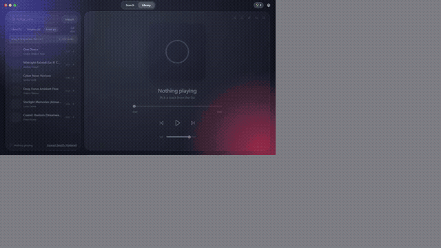

# Pulse — Open-Source Glass Music Player & Spotify Client

<div align="center">



**[▶ Watch High-Definition Showcase Video (MP4)](./release/pulse-presentation.mp4)** • **[Download Windows Installer (v1.0.3)](./release/Pulse_1.0.3_x64-setup.exe)** • **[Download Standalone .exe](./release/Pulse.exe)**

[](./LICENSE)
[](https://github.com/berkayyytech/pulse)
[](https://github.com/berkayyytech/pulse/releases)
[](./src)
[](./src/features/updater)

</div>

> **Legal & Non-Affiliation Disclaimer:**  
> **Pulse is an independent, free, open-source, non-commercial software project and is NOT affiliated with, endorsed by, certified by, or sponsored by Spotify AB.**  
> "Spotify" is a registered trademark of Spotify AB. All streamed audio, catalog metadata, and album artwork remain the property of Spotify AB and respective rightsholders. Pulse ships **zero API keys, client secrets, or shared credentials** — each user supplies their own personal Spotify Developer Client ID. See [`LEGAL_AND_COMPLIANCE.md`](./LEGAL_AND_COMPLIANCE.md) for the full compliance and attribution checklist.

---

## 🌟 Key Highlights

- **🎧 Zero Spotify Account Required (Full Offline Mode):**
  - **Local Audio Support:** Drag and drop or upload local audio files (`.mp3`, `.wav`, `.flac`, `.ogg`, `.m4a`, `.aac`, `.webm`) directly into Pulse. Audio is decoded in-browser with zero telemetry.
  - **Custom Offline Playlists:** Create, organize, name, and manage custom playlists without logging into Spotify.
  - **Out-of-the-Box Curated Catalog:** Features Drake (*"One Dance"*), ambient lo-fi, and creative-commons tape loops playable immediately with dynamic vinyl animations.
- **✨ Official Spotify Web API & Web Playback SDK Integration:**
  - **BYO Client ID:** Built strictly on official Spotify developer interfaces. Supply your own Spotify Developer Client ID via guided PKCE `S256` setup.
  - **Playback & Connect Remote:** Full synchronized playback via Web Playback SDK with Widevine EME audio and Spotify Connect remote device handoff.
  - **Live Synced Lyrics (LRCLIB):** Instant word-for-word synchronized scrolling lyrics powered by privacy-friendly LRCLIB.
- **🔄 True Background Silent Auto-Updater:**
  - Automatically queries GitHub releases (`berkayyytech/pulse`) in the background.
  - Downloads and silently applies updates without forcing users to re-download `.exe` installers from a browser.
  - Toggleable in **Settings → App Version & Automatic Updates**.
- **🎨 25 Unbreakable Token Themes & 6 Aesthetic Engines:**
  - Choose between **Frutiger Aero 2007** (specular fluid glass), **Tokyo Neon Dusk** (Vaporwave/Cyberpunk), **Phosphor CRT Terminal** (monochromatic green), **Neo-Brutalist Zine** (bold high-contrast), and **Pitch Matte Studio**.
  - 3 dynamic shell layouts (*Split Panels*, *Bottom Bar*, *Zen Stage*), 4 artwork modes (including rotating turntable vinyl), and album-adaptive background halos.
- **🏆 248 Local Achievements & Easter Eggs:**
  - Earn Bronze through Mythic trophies on-device for listening milestones, custom themes, and hidden Easter eggs (Konami code, vinyl turntable scratch, Winamp tribute, and 2007 Frutiger soap bubbles).

---

## 🚀 Running Pulse (Desktop `.exe` or Browser PWA)

### Option A — Pre-Built Windows Desktop Binaries (Ready to Run)

| Binary | Description | Size | Location |
| :--- | :--- | :--- | :--- |
| **Windows Setup Installer** | Installs Pulse, creates Start Menu & Desktop shortcuts, and supports silent auto-updates. | `~5.98 MB` | [`release/Pulse_1.0.3_x64-setup.exe`](./release/Pulse_1.0.3_x64-setup.exe) |
| **Standalone Portable `.exe`** | Double-click to launch immediately with zero installation. | `~27.18 MB` | [`release/Pulse.exe`](./release/Pulse.exe) |

*Redirect URI for Desktop `.exe`: `http://127.0.0.1:43821/auth/callback`*

### Option B — Run or Build from Source

#### Prerequisites
- **Node.js 22+** and **npm 10+**
- *(For building native `.exe` installer)*: **Rust (`rustup`)** + **MinGW-w64 / MSVC**

#### Commands

```bash
# 1. Install workspace dependencies
npm install

# 2. Start web runtime on http://127.0.0.1:5173
npm run dev

# 3. Build static PWA bundle into ./dist & preview on http://127.0.0.1:4173
npm run build
npm run preview

# 4. Build native Windows desktop .exe & NSIS installer
npm run desktop:build

# 5. Run native Tauri desktop window in live dev mode
npm run desktop:dev

# 6. Generate real software showcase video & animated GIF
npm run make:video

# 7. Quality gates (all 39 tests, strict typecheck, and lint)
npm run typecheck
npm run lint
npm test
```

---

## 🎬 Automated Video Showcase Generator

Pulse includes an automated real-software recording engine using Playwright and FFmpeg:

```bash
npm run make:video
```

This command automatically:
1. Boots the Pulse web engine on `http://127.0.0.1:4173`.
2. Launches headless Chromium at `1280x720 60fps`.
3. Demonstrates Drake search and playback with spinning vinyl, album art, and bouncing waveform visualizer.
4. Opens LRCLIB synced lyrics.
5. Showcases offline custom playlists and local file import.
6. Cycles through dynamic themes (Aero, Tokyo Neon, Phosphor CRT, Neo-Brutalist).
7. Displays background auto-updater settings and GitHub release synchronization.
8. Synthesizes a 104 BPM dancehall/synth stereo soundtrack and encodes [`release/pulse-presentation.mp4`](./release/pulse-presentation.mp4) and [`release/pulse-showcase.gif`](./release/pulse-showcase.gif).

---

## 🔑 Step-by-Step: Creating Your Spotify Client ID (Optional)

If you wish to link your Spotify account:

### Step 1 — Create an App in the Spotify Developer Dashboard
1. Sign into [https://developer.spotify.com/dashboard](https://developer.spotify.com/dashboard) with an active Spotify Premium account.
2. Click **Create app**.
3. Name it `Pulse` and check **both**:
   - `[x] Web API`
   - `[x] Web Playback SDK`

### Step 2 — Register the Exact Redirect URI (Never Use `localhost`)
Spotify disallows `http://localhost`. Add:
- **PWA / Web:** `http://127.0.0.1:5173/auth/callback` *(or `http://127.0.0.1:4173/auth/callback` for preview)*
- **Tauri Desktop App:** `http://127.0.0.1:43821/auth/callback`

### Step 3 — Paste Your Client ID into Pulse
1. Copy the **32-character hexadecimal Client ID** *(never copy or enter the Client Secret — Pulse uses PKCE and never requires a secret)*.
2. Paste it into Pulse's **Settings → Client ID** and click **Save & Test Sign-In**.

---

## 🪟 Special Window Modes

- **Compact Mini-Player:** Open `http://127.0.0.1:5173/?mode=mini` (or click Picture-in-Picture in the top-right stage).
- **OBS Studio Stream Overlay:** Add a Browser Source in OBS pointing to `http://127.0.0.1:5173/?mode=obs` (`520×140`, transparent background).
- **Command Palette:** Press `Ctrl+K` (`Cmd+K` on macOS) anywhere to jump between views, control playback, apply themes, or remap shortcuts.

---

## 📚 Documentation Index

- [`docs/ARCHITECTURE.md`](./docs/ARCHITECTURE.md) — System design, folder structure, 2026 API resilience, and data flow.
- [`CONTRIBUTING.md`](./CONTRIBUTING.md) — Development workflow, contract tests, and accessibility guidelines.
- [`LEGAL_AND_COMPLIANCE.md`](./LEGAL_AND_COMPLIANCE.md) — Legal disclaimer, attribution notice, and terms compliance.
- [`LICENSE`](./LICENSE) — MIT License.
