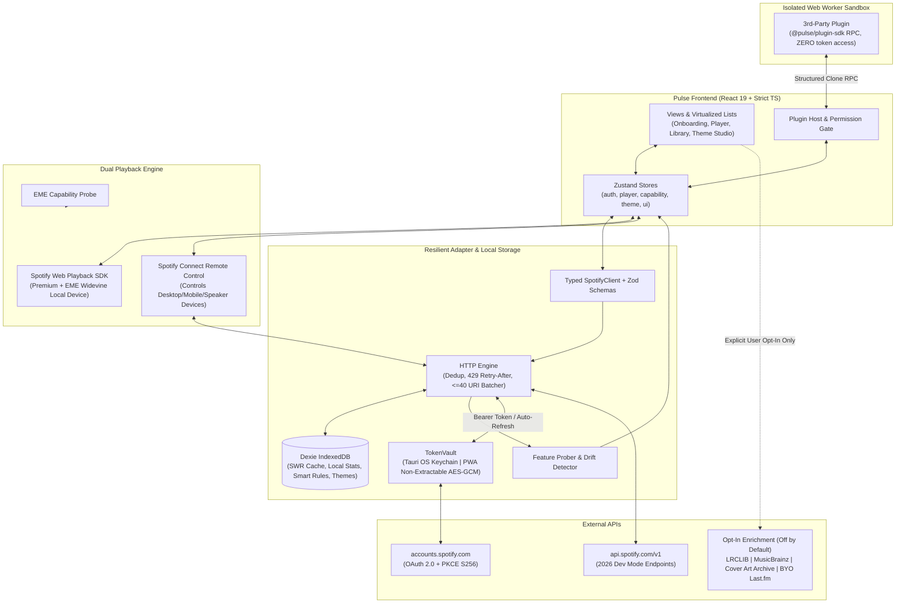
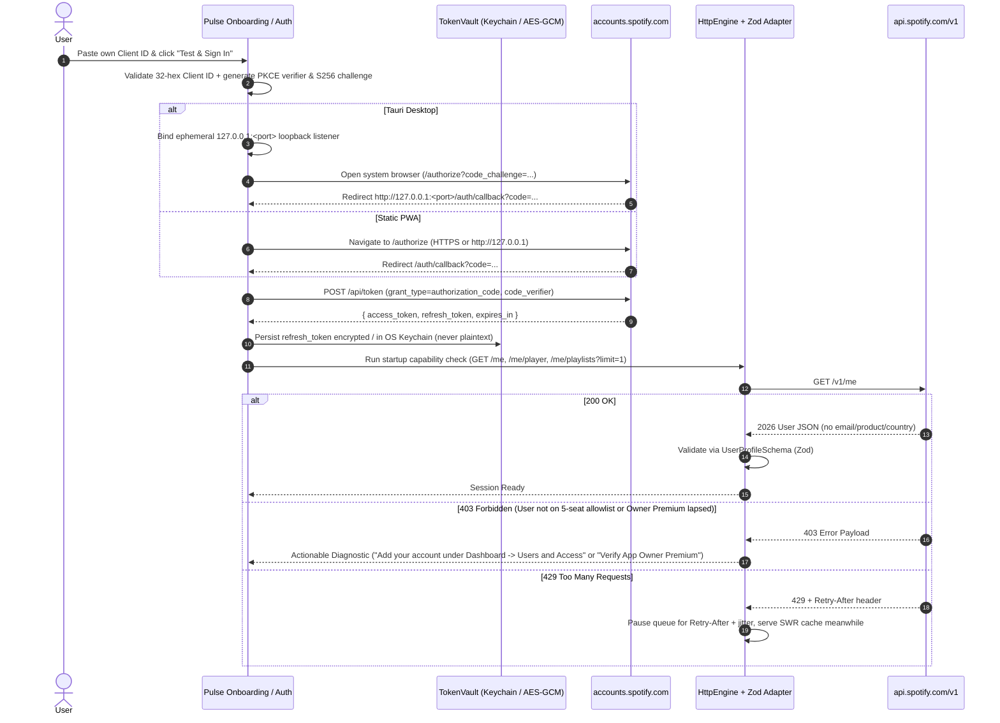

# Pulse Architecture Document

> **Status:** Deliverable 1 (v0.1.0 Foundation)  
> **License:** MIT (Standalone repository, non-commercial, BYO Spotify Client ID)  
> **Compliance Baseline:** Spotify Developer Policy & February/March 2026 Development Mode Web API Specification

---

## 1. Executive Summary & Core Architectural Principles

**Pulse** is a free, open-source, non-commercial Spotify client built exclusively on official interfaces: the **Spotify Web API** and the **Spotify Web Playback SDK**. Unlike client-patching approaches (such as Spicetify) that inject scripts and CSS selectors into Spotify's proprietary desktop binary and break whenever Spotify updates its client DOM, Pulse owns its entire UI, design-token contract, plugin runtime, and schema-validated API adapter.

Because Spotify's 2026 Development Mode rules restrict each developer app to approximately **5 authorized users** and require the **app owner to hold active Spotify Premium**, Pulse ships **zero hardcoded Client IDs or secrets**. Every user brings their own Development Mode Client ID via a guided onboarding wizard and authenticates strictly via **OAuth 2.0 Authorization Code with PKCE (`S256`)**.

### Framework & Stack Decisions

| Layer | Choice | Rationale & Trade-offs |
| :--- | :--- | :--- |
| **UI Framework** | **React 19 + TypeScript 5.8 (`strict`)** | **Why React over Svelte:** (1) React Error Boundaries isolate dynamic plugin UI slots and JSON-Schema settings forms so malformed plugin descriptors or unexpected data shapes never crash the player shell; (2) `@tanstack/react-virtual` + selector-based Zustand stores sustain 60fps scrolling on 10,000+ item playlists; (3) pure `.ts` modules share zero-magic types across the Web Worker plugin sandbox, Zod adapter, and `@pulse/plugin-sdk`. *Trade-off:* ~40 KB gzipped runtime vs Svelte's smaller baseline, offset by route-level `React.lazy()` code splitting keeping desktop cold start well under 2 seconds. |
| **State Management** | **Zustand 5** | Small, unopinionated stores (`authStore`, `capabilityStore`, `playerStore`, `themeStore`, `uiStore`, `pluginStore`) readable and writable from non-React services (Web Playback SDK listeners, HTTP 401/403/429 interceptors, Web Worker RPC host) without React Context re-render cascades. |
| **Build & PWA** | **Vite 6 + `vite-plugin-pwa`** | Produces a single static asset bundle deployable to any static host (GitHub Pages, Cloudflare Pages, local static server) with Workbox app-shell caching and zero backend server. |
| **Desktop Shell** | **Tauri v2 (Rust)** | Wraps the exact same static frontend with a lightweight OS WebView (<15 MB installer vs >120 MB Electron), adding native OS keychain storage (`keyring`), a `127.0.0.1` ephemeral loopback HTTP listener for PKCE callbacks, frameless mini-player/OBS windows, and OS global media shortcuts. |
| **Secret Storage** | **`TokenVault` (OS Keychain / Non-Extractable WebCrypto)** | Refresh tokens are **never** stored in plaintext (`localStorage`, cookies, or unencrypted IndexedDB). On Tauri, tokens live in Windows Credential Manager / macOS Keychain / Linux Secret Service. On PWA, tokens are encrypted with `AES-GCM` (256-bit) using a **non-extractable** `CryptoKey` persisted in IndexedDB. |
| **Structured Cache & Local DB** | **Dexie 4 (IndexedDB)** | Stores stale-while-revalidate API cache entries, startup capability probes, opt-in local listening history, smart playlist rule definitions, and custom theme packs. |
| **Runtime Validation** | **Zod 3** | Every Spotify API response passes through defensive Zod schemas that normalize 2026 field renames (`items` vs legacy `tracks`, `item` vs legacy `track`), strip unknown fields safely, default omitted fields, and flag schema drift without crashing UI components. |
| **Testing** | **Vitest + MSW 2 + Playwright** | Recorded 2026 Dev Mode fixtures run deterministically via Mock Service Worker (MSW) in both unit/contract suites and nightly CI smoke checks. |

---

## 2. Folder Structure

```text
pulse/
├── .github/
│   └── workflows/
│       ├── ci.yml                      # Lint, strict typecheck, Vitest, Playwright, PWA + Tauri matrix
│       └── nightly-api-contract.yml    # Fixture contract suite + optional live smoke test + auto-issue
├── docs/
│   └── ARCHITECTURE.md                 # System design, boundaries, data flow, 2026 API matrix
├── e2e/
│   └── app-shell.spec.ts               # Playwright E2E accessibility, keyboard nav & onboarding checks
├── packages/
│   ├── plugin-sdk/                     # @pulse/plugin-sdk: versioned TS types, manifest schema, Worker RPC
│   │   ├── package.json
│   │   ├── tsconfig.json
│   │   └── src/
│   │       ├── index.ts
│   │       ├── manifest.ts             # Zod schema for plugin permissions & JSON-Schema settings
│   │       └── rpc.ts                  # Structured-clone message protocol (Worker <-> Host)
│   └── create-pulse-plugin/            # CLI generator (`npx create-pulse-plugin my-plugin`)
│       ├── package.json
│       ├── tsconfig.json
│       └── src/
│           └── index.ts
├── public/
│   ├── icons/                          # PWA & Tauri icons (SVG/PNG, non-Spotify Pulse branding)
│   └── robots.txt
├── src/
│   ├── main.tsx                        # Entrypoint: initializes TokenVault, theme tokens, React root
│   ├── vite-env.d.ts
│   ├── app/
│   │   ├── App.tsx                     # App shell, lazy route suspense, keyboard command listener
│   │   ├── ErrorBoundary.tsx           # Isolates route/slot failures from the playback bar
│   │   └── ApiStatusBanner.tsx         # Surfaces 403 degradations, rate limits & schema drift notices
│   ├── i18n/
│   │   ├── index.ts                    # Lightweight externalized string lookup & formatter
│   │   └── locales/
│   │       └── en.json                 # Externalized UI copy (WCAG & localization ready)
│   ├── platform/
│   │   ├── runtime.ts                  # Detects Tauri vs PWA vs OBS compact overlay (`?mode=obs`)
│   │   ├── emeProbe.ts                 # Probes Widevine/EME availability (`requestMediaKeySystemAccess`)
│   │   ├── redirectUri.ts              # Enforces Spotify 2026 rules (`http://127.0.0.1` vs `https://`)
│   │   └── tokenVault.ts               # OS Keychain (Tauri) + AES-GCM non-extractable WebCrypto (PWA)
│   ├── api/
│   │   ├── httpClient.ts               # Dedup, Retry-After/backoff, URI batching (<=40), SWR cache
│   │   ├── spotifyClient.ts            # Typed domain methods mapped strictly to verified 2026 endpoints
│   │   ├── capabilities.ts             # Startup feature probing, 403 tracking, schema drift reporter
│   │   └── schemas/
│   │       ├── common.ts               # Shared defensive primitives (SpotifyImage, ExternalUrls)
│   │       ├── user.ts                 # 2026 User profile (omits removed email/product/country/followers)
│   │       ├── catalog.ts              # Track, Album, Artist schemas (omits popularity/markets/label)
│   │       ├── playlist.ts             # 2026 Playlist schema (`items` & `item`, optional unowned `items`)
│   │       ├── player.ts               # PlaybackState, ConnectDevice, Queue schemas
│   │       └── search.ts               # Search response schema (enforces `limit` <= 10)
│   ├── storage/
│   │   └── db.ts                       # Dexie IndexedDB schema (cache, history, smart rules, themes)
│   ├── stores/
│   │   ├── authStore.ts                # Client ID config, PKCE session status, current user profile
│   │   ├── capabilityStore.ts          # Endpoint availability map, EME playback capability, drift alerts
│   │   ├── playerStore.ts              # Unified state across Web Playback SDK & Connect Remote Control
│   │   ├── themeStore.ts               # Active design tokens, layout density, reduced-motion overrides
│   │   └── uiStore.ts                  # Sidebar placement, command palette state, multi-select state
│   ├── features/
│   │   ├── onboarding/                 # Step 3: Guided BYO Client ID wizard & human error diagnostics
│   │   ├── auth/                       # Step 3: PKCE S256 challenge, token exchange & silent refresh
│   │   ├── player/                     # Step 4: Web Playback SDK, Connect picker, MediaSession, OBS view
│   │   ├── library/                    # Step 5: Virtualized playlists/tracks/albums/artists & bulk actions
│   │   ├── search/                     # Step 5: Debounced search (`limit=10`) & catalog pages
│   │   ├── queue/                      # Step 5: Queue manager & save-queue-as-playlist
│   │   ├── themes/                     # Step 6: Token engine, live CSS var editor, album-art palette
│   │   ├── plugins/                    # Step 7: Worker sandbox host, permission gate, store index
│   │   ├── stats/                      # Step 8: Opt-in local listening history & JSON/CSV export
│   │   ├── smart-playlists/            # Step 8: Local rule AST evaluator over cached library + history
│   │   ├── lyrics/                     # Step 8: Strictly opt-in LRCLIB, MusicBrainz, CAA, BYO-key Last.fm
│   │   ├── command-palette/            # Step 8: Ctrl/Cmd+K fuzzy palette & remappable shortcut registry
│   │   └── privacy/                    # Local-only data dashboard, external provider toggles, vault wipe
│   ├── styles/
│   │   ├── tokens.css                  # `--pulse-*` CSS variable contract (Studio Glass & Warm Phosphor)
│   │   └── base.css                    # Reset, focus-visible rings (WCAG AA), reduced-motion rules
│   └── test/
│       ├── setup.ts                    # Vitest + MSW lifecycle + fake-indexeddb + WebCrypto setup
│       ├── mswServer.ts                # MSW node server wired to recorded 2026 fixtures
│       └── fixtures/
│           └── spotify2026.ts          # Authentic 2026 Dev Mode JSON payloads & error responses
├── src-tauri/
│   ├── Cargo.toml                      # Tauri v2, keyring, tiny_http (127.0.0.1 PKCE callback), serde
│   ├── build.rs
│   ├── tauri.conf.json                 # CSP, window presets (main, mini-player, obs-overlay)
│   ├── capabilities/
│   │   └── default.json                # Least-privilege Tauri v2 capability permissions
│   └── src/
│       ├── main.rs
│       └── lib.rs                      # Commands: `vault_get/set/delete`, `listen_loopback_oauth`
├── scripts/
│   └── liveSmokeTest.ts                # Optional live contract check for nightly CI (BYO CI secrets)
├── index.html
├── package.json
├── tsconfig.json
├── vite.config.ts
├── vitest.config.ts
├── playwright.config.ts
└── eslint.config.js
```

---

## 3. Module Boundaries & Strict Dependency Rules

Pulse enforces a strict directed acyclic dependency graph (enforced by TypeScript project references and ESLint import boundaries):

1. **Zero Raw Network Calls in UI (`src/features/*`, `src/app/*`)**
   - Components and Zustand actions **must never** call `window.fetch` against `api.spotify.com` or `accounts.spotify.com`.
   - All Spotify traffic traverses `src/api/spotifyClient.ts` $\rightarrow$ `src/api/httpClient.ts` $\rightarrow$ Zod schema parser (`src/api/schemas/*`).
2. **Complete Token Isolation (`src/platform/tokenVault.ts`)**
   - Only `auth` service modules can access `TokenVault` or current `access_token` values in memory.
   - Sandboxed plugins (`src/features/plugins/`) run inside dedicated **Web Workers** (`new Worker(..., { type: 'module' })`) and communicate strictly via structured-clone RPC (`@pulse/plugin-sdk`). Plugins **never** receive OAuth access tokens, refresh tokens, or the user's Client ID. Network permissions (`network:<hostname>`) are enforced by the host proxy only for explicitly approved public domains (e.g., `ws.audioscrobbler.com`, `lrclib.net`).
3. **Opt-In External Enrichment (`src/features/lyrics/`)**
   - External calls to **LRCLIB**, **MusicBrainz**, **Cover Art Archive**, and **Last.fm** are **disabled (`false`) by default**.
   - Each provider requires explicit user opt-in in Settings -> Privacy & Sources. Last.fm additionally requires a user-supplied Last.fm API key stored in `TokenVault`. Every external badge/lyric line in the UI renders an explicit source attribution pill (`Source: LRCLIB`, `Source: MusicBrainz`).
4. **Theme Isolation (`src/styles/tokens.css`, `src/features/themes/`)**
   - Themes are declarative JSON manifests mapping `--pulse-*` semantic design tokens (colors, typography, spacing, border radii, backdrop blur, motion curves). Arbitrary `<script>` execution inside theme packs is prohibited.
5. **DRM & Legal Boundary (`src/platform/emeProbe.ts`, `src/features/player/`)**
   - Pulse never bundles unofficial Widevine binaries, intercepts audio streams, skips ads, or caches audio bytes.
   - At startup, `emeProbe.ts` checks `navigator.requestMediaKeySystemAccess('com.widevine.alpha', ...)` (and `com.apple.fps` where applicable). Where supported (Desktop browsers, PWA, Windows Tauri `WebView2`), Pulse initializes the official **Spotify Web Playback SDK** (`https://sdk.scdn.co/spotify-player.js`). Where the OS WebView lacks EME (e.g., standard macOS `WKWebView`), Pulse cleanly switches to **Spotify Connect Remote Control Mode** with an optional one-click *"Open Browser Audio Bridge"* helper.

---

## 4. System Architecture & Data Flow Diagrams

### 4.1 High-Level Component & Data Flow



### 4.2 PKCE Authentication, Token Vault & Resilient Request Lifecycle



---

## 5. Verified Spotify Endpoints & 2026 Development Mode Availability

> [!IMPORTANT]
> Verified against Spotify's **February/March 2026 Web API Changelog & Migration Guide**:
> 1. **Redirect URIs:** `localhost` is **banned**. Plain HTTP is permitted **only** on loopback IP literals (`http://127.0.0.1:<port>` or `http://[::1]:<port>`); all other hosts require `https://`.
> 2. **Unified Library Endpoints:** Legacy entity-specific write/check endpoints (`PUT/DELETE /me/tracks`, `/me/albums`, `/me/following`) were **removed** and consolidated into `PUT /me/library`, `DELETE /me/library`, and `GET /me/library/contains` (max **40 Spotify URIs** per request).
> 3. **Playlist Renames & Unowned Restrictions:** Playlist routes moved from `/playlists/{id}/tracks` to `/playlists/{id}/items`, `POST /users/{user_id}/playlists` moved to `POST /me/playlists`, playlist summary `tracks` was renamed to `items`, and item `track` was renamed to `item`. Unowned/editorial/algorithmic playlists omit `items` (`undefined`) in Development Mode.
> 4. **Search Throttle & Removed Catalog Endpoints:** `GET /search` `limit` maximum dropped from `50` to **`10`** (default `5`). Bulk catalog endpoints (`GET /tracks`, `GET /albums`, `GET /artists`) and `GET /artists/{id}/top-tracks`, `GET /browse/new-releases`, `GET /browse/categories` were **removed**.
> 5. **Removed Object Fields:** `user.product`, `user.email`, `user.country`, `user.explicit_content`, `user.followers`, `track.popularity`, `track.available_markets`, `track.external_ids`, `track.linked_from`, `artist.popularity`, `artist.followers`, `album.popularity`, `album.available_markets`, and `album.label` are no longer relied upon anywhere in Pulse.

### 5.1 Active Endpoints Used by Pulse

| Domain | Method & Path | Required Scope(s) | 2026 Dev Mode Status & Limits | 2026 Schema / Field Notes & Pulse Resilience Behavior |
| :--- | :--- | :--- | :--- | :--- |
| **Auth** | `GET https://accounts.spotify.com/authorize` | Dynamic per feature | **Available** (PKCE `S256` mandatory; max ~5 allowlisted users per Client ID) | Uses `http://127.0.0.1:<port>/auth/callback` on loopback or `https://` on hosted PWA. Never uses `localhost` or implicit flow. |
| **Auth** | `POST https://accounts.spotify.com/api/token` | — | **Available** (`authorization_code` & `refresh_token`) | Rotated `refresh_token` immediately overwrites previous entry in `TokenVault`. |
| **Profile** | `GET /v1/me` | *(authenticated token)* | **Available** (Owner must have active Premium) | Returns `id`, `display_name`, `images`, `uri`, `external_urls`. **Omits** `product`, `email`, `country`, `followers`. Premium status is inferred via SDK `account_error` & `/me/player` responses, never `user.product`. |
| **Player** | `GET /v1/me/player` | `user-read-playback-state` | **Available** (`200` state or `204` no active device) | Validates `item` defensively; handles null device or local file tracks without crashing. |
| **Player** | `GET /v1/me/player/currently-playing` | `user-read-currently-playing` | **Available** | Lightweight fallback poll for compact/OBS overlay mode. |
| **Player** | `GET /v1/me/player/devices` | `user-read-playback-state` | **Available** | Powers the Connect device picker & Remote Control target selector. |
| **Player** | `PUT /v1/me/player` | `user-modify-playback-state` | **Available** (Premium required) | Transfers active playback between Pulse's Web Playback SDK `device_id` and external Connect devices. |
| **Player** | `PUT /v1/me/player/play` | `user-modify-playback-state` | **Available** (Premium required) | Starts/resumes context URI or track URI list; surfaces human message on `403 PREMIUM_REQUIRED`. |
| **Player** | `PUT /v1/me/player/pause` | `user-modify-playback-state` | **Available** (Premium required) | Pauses active Connect or SDK device. |
| **Player** | `POST /v1/me/player/next` | `user-modify-playback-state` | **Available** (Premium required) | Skips to next item. |
| **Player** | `POST /v1/me/player/previous` | `user-modify-playback-state` | **Available** (Premium required) | Skips to previous item. |
| **Player** | `PUT /v1/me/player/seek` | `user-modify-playback-state` | **Available** (Premium required) | Seeks `position_ms`. |
| **Player** | `PUT /v1/me/player/volume` | `user-modify-playback-state` | **Available** (Premium; device-dependent) | Gracefully disables slider if target Connect device reports `supports_volume === false` or `403`. |
| **Player** | `PUT /v1/me/player/shuffle` | `user-modify-playback-state` | **Available** (Premium required) | Toggles `state=true/false`. |
| **Player** | `PUT /v1/me/player/repeat` | `user-modify-playback-state` | **Available** (Premium required) | Cycles `off` / `context` / `track`. |
| **Queue** | `GET /v1/me/player/queue` | `user-read-playback-state`, `user-read-currently-playing` | **Available** (Probed at startup) | Syncs remote queue with Pulse's local virtual queue reorder buffer. Degrades to local queue view on `403`. |
| **Queue** | `POST /v1/me/player/queue` | `user-modify-playback-state` | **Available** (Premium required) | Appends `uri` to active device queue. |
| **History** | `GET /v1/me/player/recently-played` | `user-read-recently-played` | **Available** (`limit` 1–50, cursor `before`/`after`) | Seeds opt-in local listening history if user enables history sync; skipped entirely until opted in. |
| **Library** | `GET /v1/me/tracks` | `user-library-read` | **Available** (`limit` 1–50, `offset`) | Paginates saved tracks into Dexie SWR cache for instant virtualized 10k+ track scrolling & smart playlist evaluation. |
| **Library** | `GET /v1/me/albums` | `user-library-read` | **Available** (`limit` 1–50, `offset`) | Album objects omit `label`, `popularity`, `available_markets`. |
| **Library** | `GET /v1/me/following?type=artist` | `user-follow-read` | **Available** (`type=artist` mandatory; cursor `after`, `limit` 1–50) | Artist objects omit `popularity` and `followers`. |
| **Library** | `PUT /v1/me/library` | `user-library-modify`, `user-follow-modify`, `playlist-modify-*` | **Available (2026 Unified Route)** — Max **40 URIs** in `?uris=` | `HttpEngine` automatically batches bulk multi-select saves into chunks of $\le 40$ Spotify URIs (`spotify:track:*`, `spotify:album:*`, `spotify:artist:*`, `spotify:playlist:*`). |
| **Library** | `DELETE /v1/me/library` | `user-library-modify`, `user-follow-modify`, `playlist-modify-*` | **Available (2026 Unified Route)** — Max **40 URIs** in `?uris=` | Chunked $\le 40$ URIs per call; replaces removed `DELETE /me/tracks`, `/me/albums`, `/me/following`. |
| **Library** | `GET /v1/me/library/contains` | `user-library-read`, `user-follow-read` | **Available (2026 Unified Route)** — Max **40 URIs** in `?uris=` | Micro-batched & deduplicated across visible virtualized rows; returns `boolean[]`. |
| **Playlists** | `GET /v1/me/playlists` | `playlist-read-private`, `playlist-read-collaborative` | **Available** (`limit` 1–50) | Zod normalizes `items` summary (`{ href, total }`), falling back to `tracks` only if a transitional node returns it. |
| **Playlists** | `POST /v1/me/playlists` | `playlist-modify-public`, `playlist-modify-private` | **Available (2026 Replacement)** | Used for creating playlists, saving queues as playlists, and materializing Smart Playlists. Replaces removed `POST /users/{id}/playlists`. |
| **Playlists** | `GET /v1/playlists/{playlist_id}` | `playlist-read-private` | **Restricted on Unowned/Editorial** | Owned/collaborative playlists return full data; algorithmic/editorial playlists omit `items` (`undefined`) or return `403`. UI displays clear Dev Mode explanation banner when `items` is omitted. |
| **Playlists** | `PUT /v1/playlists/{playlist_id}` | `playlist-modify-public`, `playlist-modify-private` | **Available** (Owned playlists) | Updates title, description, and visibility. |
| **Playlists** | `GET /v1/playlists/{playlist_id}/items` | `playlist-read-private`, `playlist-read-collaborative` | **Available (2026 Renamed Route)** (`limit` 1–50) | Zod parses each entry's `item` (track/episode) with fallback normalization for `track` and safely skips `item: null` (unavailable/deleted tracks). |
| **Playlists** | `POST /v1/playlists/{playlist_id}/items` | `playlist-modify-public`, `playlist-modify-private` | **Available (2026 Renamed Route)** (Max 100 URIs) | Used by bulk multi-select "Add to Playlist" (chunked $\le 100$ URIs). |
| **Playlists** | `PUT /v1/playlists/{playlist_id}/items` | `playlist-modify-public`, `playlist-modify-private` | **Available (2026 Renamed Route)** | Used for drag-and-drop / keyboard item reordering with `snapshot_id` optimistic concurrency. |
| **Playlists** | `DELETE /v1/playlists/{playlist_id}/items` | `playlist-modify-public`, `playlist-modify-private` | **Available (2026 Renamed Route)** | Removes selected URI occurrences from owned/collaborative playlists. |
| **Search** | `GET /v1/search` | *(authenticated token)* | **Throttled in 2026 Dev Mode:** **`limit` max `10`**, default `5` | `SpotifyClient.search()` strictly clamps `limit` to `1..10` so Pulse never triggers `400 Invalid limit` under 2026 rules; supports pagination via `offset`. |
| **Catalog** | `GET /v1/albums/{id}` & `GET /v1/albums/{id}/tracks` | *(authenticated token)* | **Available (Single-ID only)** | Cached in Dexie SWR store (`album:{id}`). Album `external_ids` (reverted back in March 2026) parsed as optional; `label` & `popularity` never required. |
| **Catalog** | `GET /v1/artists/{id}` & `GET /v1/artists/{id}/albums` | *(authenticated token)* | **Available (Single-ID only)** | Powers Artist pages alongside user's saved tracks by that artist (since `/artists/{id}/top-tracks` is removed). |
| **Catalog** | `GET /v1/tracks/{id}` | *(authenticated token)* | **Available (Single-ID only)** | In-flight deduplicated + cached in Dexie (`track:{id}`). |
| **Top** | `GET /v1/me/top/tracks` & `GET /v1/me/top/artists` | `user-top-read` | **Available** (Probed via `capabilities.ts`) | Supplements local opt-in listening stats; gracefully hidden if endpoint returns `403`. |

### 5.2 Removed / Forbidden Endpoints (Never Called by Pulse)

To prevent accidental regressions, Pulse's `SpotifyClient` intentionally omits and lints against these removed pre-2026 endpoints:

| Removed Endpoint | 2026 Replacement / Pulse Strategy |
| :--- | :--- |
| `PUT /v1/me/tracks`, `DELETE /v1/me/tracks`, `GET /v1/me/tracks/contains` | Unified `PUT / DELETE /v1/me/library?uris=...` & `GET /v1/me/library/contains?uris=...` |
| `PUT /v1/me/albums`, `DELETE /v1/me/albums`, `GET /v1/me/albums/contains` | Unified `PUT / DELETE /v1/me/library?uris=...` & `GET /v1/me/library/contains?uris=...` |
| `PUT /v1/me/following`, `DELETE /v1/me/following`, `GET /v1/me/following/contains` | Unified `PUT / DELETE /v1/me/library?uris=...` & `GET /v1/me/library/contains?uris=...` |
| `POST /v1/users/{user_id}/playlists` | `POST /v1/me/playlists` |
| `GET / POST / PUT / DELETE /v1/playlists/{id}/tracks` | `GET / POST / PUT / DELETE /v1/playlists/{id}/items` |
| `GET /v1/artists/{id}/top-tracks` | Artist Discography (`GET /v1/artists/{id}/albums`) + User's Saved Tracks by Artist + optional opt-in Last.fm top tracks |
| `GET /v1/tracks?ids=...`, `GET /v1/albums?ids=...`, `GET /v1/artists?ids=...` | Single-ID routes + Dexie IndexedDB SWR cache + request deduplication |
| `GET /v1/browse/new-releases`, `GET /v1/browse/categories`, `GET /v1/recommendations`, `GET /v1/audio-features` | Replaced by local Smart Playlists, personal `GET /v1/me/top/*`, and followed-artist album release checks |

---

## 6. Resilience, CI Contract Verification & Accessibility Targets

1. **Startup Capability Probing (`src/api/capabilities.ts`)**:
   - On session start (cached for 6 hours in Dexie or re-run manually), Pulse probes key capability groups (`profile`, `player`, `queue`, `library`, `playlists`, `topItems`, and `emeAudio`).
   - Any `403` marks that capability `'degraded'` with a plain-English reason surfaced in `<ApiStatusBanner />` and the Diagnostics drawer rather than throwing unhandled rejections.
2. **Schema Drift Detection**:
   - Zod schemas use `.passthrough()` inspection inside a wrapper parser that logs unexpected missing core fields or newly renamed keys into `capabilityStore.schemaWarnings`, alerting the user via a non-intrusive status banner with a "Copy Diagnostic Report" button.
3. **Nightly Contract & Live Smoke CI (`.github/workflows/nightly-api-contract.yml`)**:
   - Runs nightly at 03:00 UTC:
     1. Executes Vitest contract suites against recorded 2026 Dev Mode fixtures (`spotify2026.ts`).
     2. If repository owner secrets (`SPOTIFY_CLIENT_ID`, `SPOTIFY_REFRESH_TOKEN`) are configured in the user's fork, runs `scripts/liveSmokeTest.ts` against live `api.spotify.com/v1` endpoints to detect undocumented upstream Spotify changes.
     3. Automatically opens or updates a `spotify-api-drift` GitHub Issue via `actions/github-script` on failure.
4. **Performance, Accessibility & Privacy**:
   - **WCAG 2.1 AA:** High-contrast token pairs ($\ge 4.5:1$ body text, $\ge 3:1$ controls), visible `:focus-visible` outlines, full `aria-label` / landmark semantics, and `@media (prefers-reduced-motion: reduce)` zero-animation mode.
   - **Performance:** Route-level `React.lazy`, `@tanstack/react-virtual` row virtualization, zero render-blocking scripts (`spotify-player.js` injected lazily after auth + EME probe), cold start < 2s.
   - **Privacy:** Zero telemetry, zero analytics SDKs, strictly opt-in third-party enrichment, one-click complete local wipe (`Dexie.delete` + `TokenVault.clear`).
